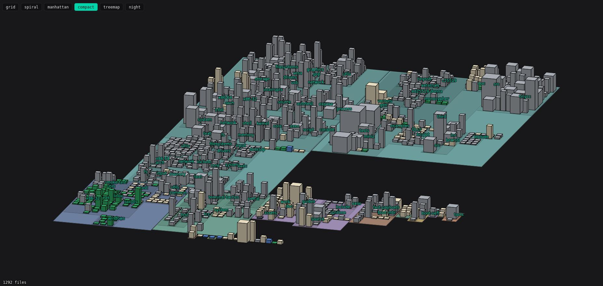

# CodeCity



CodeCity renders any codebase as an isometric 3D city on a plain canvas: every folder nests as a city block, every file stands as one square cuboid, and only the cuboid height carries the line count.

## Usage

```sh
npm install
npm run typecheck
npm test
node tools/build-city.mjs [directory] [grid|spiral|manhattan|compact|treemap] [ignore,comma,list]
```

Or the idempotent shortcut (installs when missing, builds, opens in the browser):

on Linux/macOS:
```sh
./scripts/linux/run.sh --path <directory> --layout compact [--no-open]
```
on Windows:
```bat
scripts\windows\run.bat --path <directory> --layout compact [--no-open]
```

## Manual

### Build options

The visualizer ignores `package.json` and `package-lock.json` by default.
Pass an empty third argument to keep every file.

Layout dispositions (second argument):

- `grid` / `spiral` / `manhattan` — classic grid-family layouts.
- `compact` — queues children biggest-first in centered shelf rows with no
  column stretching, for dense blocks where grid alignment wastes space.
- `treemap` — tiles every directory by line count; both area and raw height
  encode size.

### Viewer controls

- Drag to rotate, wheel to zoom, shift-drag to pan, hover to read paths.
- Folder names fade in with zoom; file names appear deeper in.

### Visual encoding

- Plates keep their district colors and darken one step per nesting level,
  so depth reads off the ground.
- Buildings read their file kind instead:
  - code — light gray
  - shell — terminal green
  - config — steel blue
  - plain text — warm paper
  - binaries — dark slate
- Code and shell earn lit windows when zoomed in.

### Night mode

A `night` button in the top bar (or `?night=1`) darkens the whole scene to
one third of its brightness while windows keep full glow.

### File preview

Clicking a building opens a right-side viewer drawer with its scrollable file
content (capped at 400 lines / 32k chars). Binaries and empty files show a
no-preview note. The drawer syntax-colors 21 languages through a bundled
highlighter (`src/` stays dependency-free via injected hooks) and falls back
to plain text otherwise.

## Layout

- `src/` holds the whole module with no outside dependency: types, folder-tree builder, grid layout, dynamic camera with projection, zoom-driven labels, and the canvas renderer. Files past three times the mean height widen their square footprint instead of rising.
- `test/` runs the geometry proof (counts, overlap, extent, determinism, rotation, labels) on a synthetic tree.
- `tools/` builds a self-contained `<project>-city.html` visualizer from any directory on disk into `output/`.
